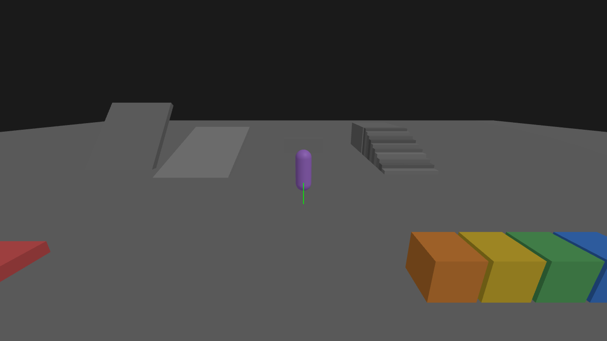
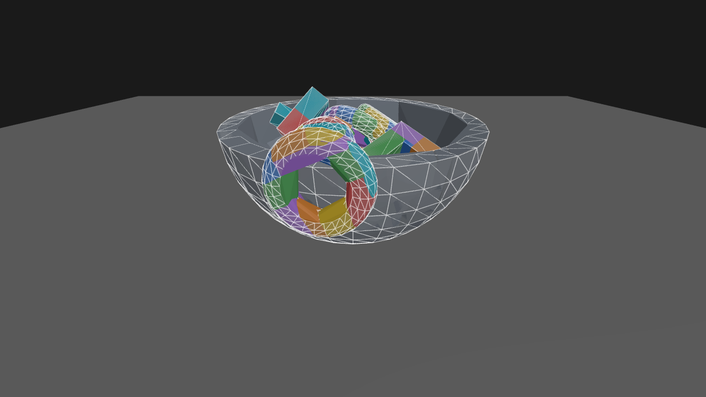
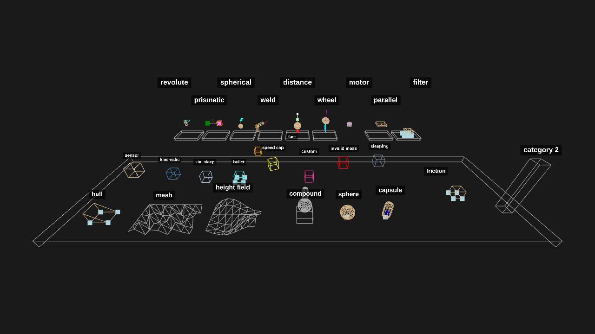
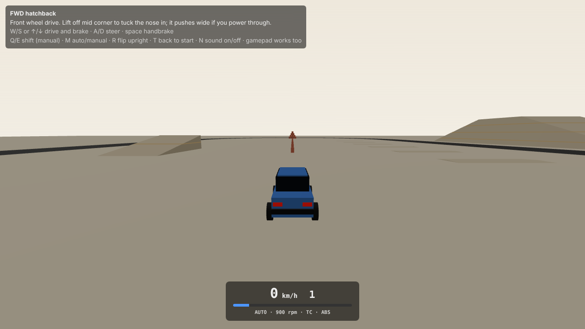
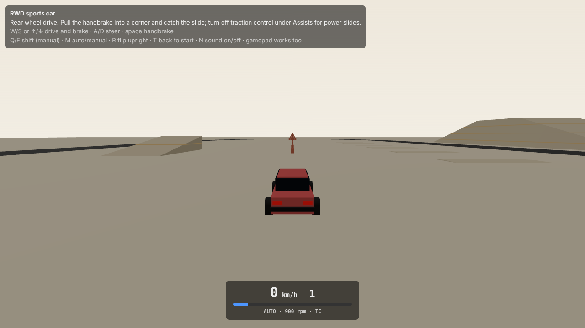
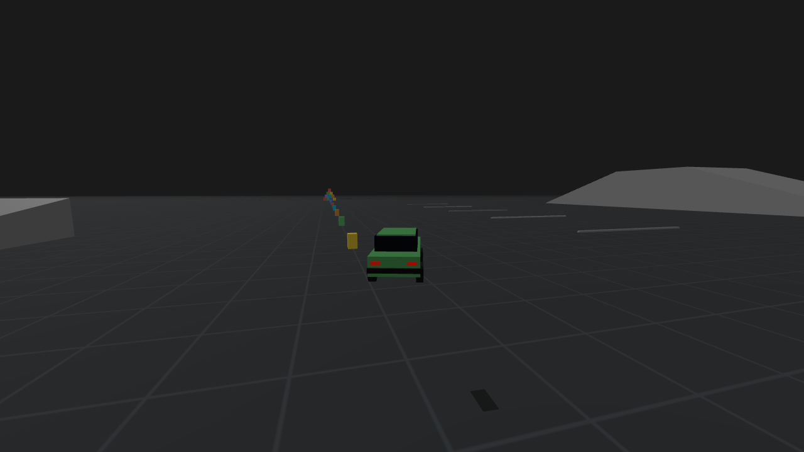
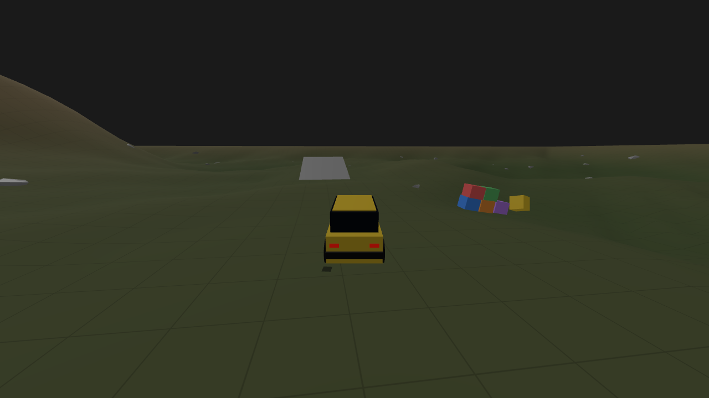
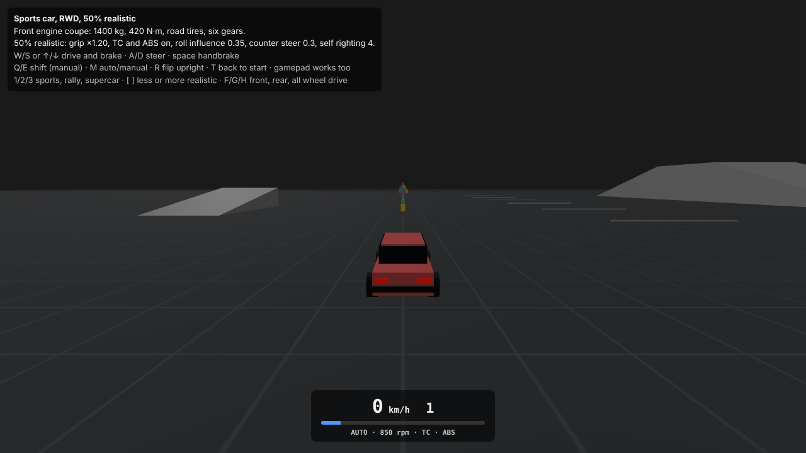

# box3d.js

WebAssembly bindings for [box3d](https://github.com/erincatto/box3d) - Erin Catto's 3D rigid body physics engine - compiled with Emscripten and exposed as an ES module with full TypeScript definitions.

The API mirrors the box3d C API 1:1 (`b3CreateWorld`, `b3World_Step`, …) so the upstream docs and samples translate relatively directly.

```bash
npm install box3d.js
```

**Builds**

| Import | Use case |
|--------|----------|
| `box3d.js/inline` | Browser - single-file, no separate `.wasm` to serve |
| `box3d.js` | Node.js or bundlers that can serve `.wasm` |
| `box3d.js/mt-inline` | Browser + multithreading (requires cross-origin isolation) |
| `box3d.js/mt` | Node.js + multithreading |

**Examples**

<table>
  <tr>
    <td align="center">
      <a href="https://nilo-technologies.github.io/box3d.js/#example-shapes">
        <br/>
        Shapes
      </a>
    </td>
    <td align="center">
      <a href="https://nilo-technologies.github.io/box3d.js/#example-cube-heap">
        <br/>
        Cube Heap
      </a>
    </td>
    <td align="center">
      <a href="https://nilo-technologies.github.io/box3d.js/#example-stacking">
        <br/>
        Stacking
      </a>
    </td>
  </tr>
  <tr>
    <td align="center">
      <a href="https://nilo-technologies.github.io/box3d.js/#example-robustness">
        <br/>
        Robustness
      </a>
    </td>
    <td align="center">
      <a href="https://nilo-technologies.github.io/box3d.js/#example-restitution">
        <br/>
        Restitution
      </a>
    </td>
    <td align="center">
      <a href="https://nilo-technologies.github.io/box3d.js/#example-friction">
        <br/>
        Friction
      </a>
    </td>
  </tr>
  <tr>
    <td align="center">
      <a href="https://nilo-technologies.github.io/box3d.js/#example-conveyor-belt">
        <br/>
        Conveyor Belt
      </a>
    </td>
    <td align="center">
      <a href="https://nilo-technologies.github.io/box3d.js/#example-ccd">
        <br/>
        Continuous Collision Detection
      </a>
    </td>
    <td align="center">
      <a href="https://nilo-technologies.github.io/box3d.js/#example-gravity-factor">
        <br/>
        Gravity Factor
      </a>
    </td>
  </tr>
  <tr>
    <td align="center">
      <a href="https://nilo-technologies.github.io/box3d.js/#example-linear-damping">
        <br/>
        Linear Damping
      </a>
    </td>
    <td align="center">
      <a href="https://nilo-technologies.github.io/box3d.js/#example-angular-damping">
        <br/>
        Angular Damping
      </a>
    </td>
    <td align="center">
      <a href="https://nilo-technologies.github.io/box3d.js/#example-add-impulse-at-position">
        <br/>
        Add Impulse at Position
      </a>
    </td>
  </tr>
  <tr>
    <td align="center">
      <a href="https://nilo-technologies.github.io/box3d.js/#example-collision-filtering">
        <br/>
        Collision Filtering
      </a>
    </td>
    <td align="center">
      <a href="https://nilo-technologies.github.io/box3d.js/#example-joints">
        <br/>
        Joints
      </a>
    </td>
    <td align="center">
      <a href="https://nilo-technologies.github.io/box3d.js/#example-ragdoll">
        <br/>
        Ragdoll
      </a>
    </td>
  </tr>
  <tr>
    <td align="center">
      <a href="https://nilo-technologies.github.io/box3d.js/#example-character">
        <br/>
        Character
      </a>
    </td>
    <td align="center">
      <a href="https://nilo-technologies.github.io/box3d.js/#example-dynamic-mover">
        <br/>
        Dynamic Mover
      </a>
    </td>
    <td align="center">
      <a href="https://nilo-technologies.github.io/box3d.js/#example-static-compound">
        <br/>
        Static Compound
      </a>
    </td>
  </tr>
  <tr>
    <td align="center">
      <a href="https://nilo-technologies.github.io/box3d.js/#example-convex-decomposition">
        <br/>
        Convex Decomposition
      </a>
    </td>
    <td align="center">
      <a href="https://nilo-technologies.github.io/box3d.js/#example-triangle-mesh">
        <br/>
        Triangle Mesh
      </a>
    </td>
    <td align="center">
      <a href="https://nilo-technologies.github.io/box3d.js/#example-mesh">
        <br/>
        Mesh Generators
      </a>
    </td>
  </tr>
  <tr>
    <td align="center">
      <a href="https://nilo-technologies.github.io/box3d.js/#example-cast-ray">
        <br/>
        Cast Ray
      </a>
    </td>
    <td align="center">
      <a href="https://nilo-technologies.github.io/box3d.js/#example-cast-shape">
        <br/>
        Cast Shape
      </a>
    </td>
    <td align="center">
      <a href="https://nilo-technologies.github.io/box3d.js/#example-hinge-motor">
        <br/>
        Hinge Motor
      </a>
    </td>
  </tr>
  <tr>
    <td align="center">
      <a href="https://nilo-technologies.github.io/box3d.js/#example-gjk">
        <br/>
        GJK Distance
      </a>
    </td>
    <td align="center">
      <a href="https://nilo-technologies.github.io/box3d.js/#example-manifold">
        <br/>
        Manifold
      </a>
    </td>
    <td align="center">
      <a href="https://nilo-technologies.github.io/box3d.js/#example-tree">
        <br/>
        Dynamic Tree
      </a>
    </td>
  </tr>
  <tr>
    <td align="center">
      <a href="https://nilo-technologies.github.io/box3d.js/#example-explosion">
        <br/>
        Explosion
      </a>
    </td>
    <td align="center">
      <a href="https://nilo-technologies.github.io/box3d.js/#example-geometry">
        <br/>
        Geometry
      </a>
    </td>
    <td align="center">
      <a href="https://nilo-technologies.github.io/box3d.js/#example-sensor">
        <br/>
        Sensor
      </a>
    </td>
  </tr>
  <tr>
    <td align="center">
      <a href="https://nilo-technologies.github.io/box3d.js/#example-events">
        <br/>
        Events
      </a>
    </td>
    <td align="center">
      <a href="https://nilo-technologies.github.io/box3d.js/#example-contacts">
        <br/>
        Contacts
      </a>
    </td>
    <td align="center">
      <a href="https://nilo-technologies.github.io/box3d.js/#example-multithreading">
        <br/>
        Multithreading
      </a>
    </td>
  </tr>
  <tr>
    <td align="center">
      <a href="https://nilo-technologies.github.io/box3d.js/#example-debug-draw">
        <br/>
        Debug Draw
      </a>
    </td>
    <td align="center">
      <a href="https://nilo-technologies.github.io/box3d.js/#example-replay">
        <br/>
        Replay
      </a>
    </td>
    <td align="center">
      <a href="https://nilo-technologies.github.io/box3d.js/#example-vehicle-fwd">
        <br/>
        Vehicle: FWD hatchback
      </a>
    </td>
  </tr>
  <tr>
    <td align="center">
      <a href="https://nilo-technologies.github.io/box3d.js/#example-vehicle-rwd">
        <br/>
        Vehicle: RWD sports car
      </a>
    </td>
    <td align="center">
      <a href="https://nilo-technologies.github.io/box3d.js/#example-vehicle-awd">
        <br/>
        Vehicle: AWD road car
      </a>
    </td>
    <td align="center">
      <a href="https://nilo-technologies.github.io/box3d.js/#example-vehicle-offroad">
        <br/>
        Vehicle: AWD off-roader
      </a>
    </td>
  </tr>
  <tr>
    <td align="center">
      <a href="https://nilo-technologies.github.io/box3d.js/#example-vehicle-showcase">
        <br/>
        Vehicle: preset showcase
      </a>
    </td>
  </tr>
</table>


## Table of Contents

- [Quick Start](#quick-start)
- [What Is box3d?](#what-is-box3d)
- [Physics World](#physics-world)
- [Rigid Bodies](#rigid-bodies)
- [Shapes](#shapes)
- [Joints](#joints)
- [Vehicles](#vehicles)
- [Queries](#queries)
- [Events](#events)
- [Debug Draw](#debug-draw)
- [Character Controller](#character-controller)
- [Multithreading](#multithreading)
- [Building from Source](#building-from-source)

## Quick Start

Initialize the WASM module once with `await Box3D()`, then call the physics API through the returned module object.

```ts
import Box3D from 'box3d.js';
import type { Box3DModule, b3Vec3 } from 'box3d.js';

// Initialize the WASM module. Use box3d.js/inline if your environment can't serve a separate .wasm file.
const b3: Box3DModule = await Box3D();

// Create a world with downward gravity. Math types are plain arrays: b3Vec3 is [x, y, z].
const worldDef = b3.b3DefaultWorldDef();
worldDef.gravity = [0, -10, 0];
const world = b3.b3CreateWorld(worldDef);

// Static ground: a wide flat box
const groundDef = b3.b3DefaultBodyDef();
groundDef.position = [0, 0, 0];
const ground = b3.b3CreateBody(world, groundDef);
b3.b3CreateBoxShape(ground, b3.b3DefaultShapeDef(), 25, 0.5, 25);

// Dynamic sphere dropped from above
const bodyDef = b3.b3DefaultBodyDef();
bodyDef.type = b3.b3BodyType.b3_dynamicBody;
bodyDef.position = [0, 10, 0];
const body = b3.b3CreateBody(world, bodyDef);
b3.b3CreateSphereShape(body, b3.b3DefaultShapeDef(), { center: [0, 0, 0], radius: 0.5 });

// Step the simulation at 60 Hz for ~2.5 seconds
for (let i = 0; i < 150; i++) {
    b3.b3World_Step(world, 1 / 60, 4);
}

// Getters are out-param-first: pass a scratch array to fill (zero-allocation).
const pos: b3Vec3 = [0, 0, 0];
b3.b3Body_GetPosition(pos, body);
console.log(`sphere landed at y = ${pos[1].toFixed(2)}`);

b3.b3DestroyWorld(world);
```

## What Is box3d?

box3d is Erin Catto's 3D rigid body engine — the 3D sibling of Box2D, from the author of Box2D itself.

## Physics World

### Creating a World

```ts
const worldDef = b3.b3DefaultWorldDef();
worldDef.gravity = [0, -10, 0];

const world = b3.b3CreateWorld(worldDef);
```

`b3DefaultWorldDef()` returns a world definition with sensible defaults. Common fields to override:

| Field | Type | Default | Description |
|-------|------|---------|-------------|
| `gravity` | `b3Vec3` | `[0, 0, 0]` | World gravity vector |
| `workerCount` | `number` | `0` | Thread count for the MT build (see [Multithreading](#multithreading)) |
| `maximumLinearSpeed` | `number` | `500` | Speed cap - raise this for CCD bullet bodies |

### Stepping the Simulation

```ts
// Advance the simulation by one fixed time step.
// subStepCount controls accuracy vs. performance (4 is a good default).
b3.b3World_Step(world, 1 / 60, 4);
```

Call `b3World_Step` in your game loop. `subStepCount` controls solver accuracy - 4 is a good default.

```ts
// Typical browser game loop
function animate() {
    b3.b3World_Step(world, 1 / 60, 4);
    // ... update mesh transforms from body positions ...
    requestAnimationFrame(animate);
}
requestAnimationFrame(animate);
```

### Destroying a World

```ts
// Always destroy the world when you are done to free WASM memory.
b3.b3DestroyWorld(world);
```

### Memory Management

box3d.js wraps a WASM module, so some objects are allocated on the WASM heap and must be freed explicitly.

**Hull data is copied** into the world's internal database on shape creation, so `b3HullData` handles can be destroyed immediately after - or reused across multiple shapes before being destroyed.

**Mesh, compound, and heightfield data are not copied** - the world stores a raw pointer. `b3MeshData`, `b3CompoundData`, and `b3HeightFieldData` must be kept alive for as long as the shape (or world) exists, and destroyed only after.

```ts
// Hull data IS copied into the world's internal database on shape creation,
// so the handle can be destroyed immediately after — or reused to stamp out
// multiple shapes and destroyed when no longer needed.
const hull = b3.b3CreateHull(positions)!;
const bodyA = b3.b3CreateBody(world, b3.b3DefaultBodyDef());
b3.b3CreateHullShape(bodyA, b3.b3DefaultShapeDef(), hull);
b3.b3DestroyHull(hull); // safe — world keeps its own copy

// Mesh, compound, and heightfield data are NOT copied. The world stores a raw
// pointer to the data, so it must be kept alive for as long as the shape (or
// world) exists. Destroy it only after the shape or world has been destroyed.
const mesh = b3.b3CreateMesh(positions, indices)!;
const bodyB = b3.b3CreateBody(world, b3.b3DefaultBodyDef());
b3.b3CreateMeshShape(bodyB, b3.b3DefaultShapeDef(), mesh, [1, 1, 1]);
// b3.b3DestroyMesh(mesh) — NOT safe here; the shape still holds a pointer to it
b3.b3DestroyWorld(world);
b3.b3DestroyMesh(mesh); // safe now — world (and its shapes) are gone
```

**Destroying a world** frees all bodies, shapes, and joints inside it automatically - no need to clean them up individually first.

```ts
// b3DestroyWorld frees all bodies, shapes, and joints inside it automatically.
// Call it once at teardown — no need to destroy individual objects first.
b3.b3DestroyWorld(world2);
```

**Removing objects during simulation** - use the individual destroy functions. Destroying a body also removes all its shapes and any joints attached to it.

```ts
// Destroying a body also removes all its shapes and any joints attached to it.
const dynDef = b3.b3DefaultBodyDef();
dynDef.type = b3.b3BodyType.b3_dynamicBody;
const dynBody = b3.b3CreateBody(world3, dynDef);
b3.b3CreateBoxShape(dynBody, b3.b3DefaultShapeDef(), 0.5, 0.5, 0.5);
b3.b3DestroyBody(dynBody); // body, its shapes, and attached joints all removed

// To remove one shape from a multi-shape body without destroying the body,
// use b3DestroyShape. The boolean controls whether body mass is recalculated.
const multiBody = b3.b3CreateBody(world3, b3.b3DefaultBodyDef());
const shapeA = b3.b3CreateBoxShape(multiBody, b3.b3DefaultShapeDef(), 0.5, 0.5, 0.5);
b3.b3CreateSphereShape(multiBody, b3.b3DefaultShapeDef(), { center: [0, 1, 0], radius: 0.3 });
b3.b3DestroyShape(shapeA, true); // removes shapeA and recalculates body mass

// Joints can also be destroyed independently. The boolean controls whether
// the connected bodies are woken up.
const bodyC = b3.b3CreateBody(world3, b3.b3DefaultBodyDef());
const bodyD = b3.b3CreateBody(world3, b3.b3DefaultBodyDef());
const jd = b3.b3DefaultDistanceJointDef();
jd.base.bodyIdA = bodyC;
jd.base.bodyIdB = bodyD;
const joint = b3.b3CreateDistanceJoint(world3, jd);
b3.b3DestroyJoint(joint, true); // removes joint; true = wake the connected bodies
```

### Units and Scale

box3d uses SI units and a right-handed coordinate system (+Y up by default):

- **Length**: metres (m)
- **Mass**: kilograms (kg) - note: default shape density is **1000 kg/m³**
- **Time**: seconds (s)
- **Triangle winding**: counter-clockwise (CCW) is the front face

## Rigid Bodies

### Body Types

```ts
// Static: immovable; infinite mass; collides with dynamic bodies
const staticDef = b3.b3DefaultBodyDef();
staticDef.type = b3.b3BodyType.b3_staticBody;
staticDef.position = [0, 0, 0];
const staticBody = b3.b3CreateBody(world, staticDef);
b3.b3CreateBoxShape(staticBody, b3.b3DefaultShapeDef(), 10, 0.5, 10);

// Dynamic: fully simulated; affected by forces and gravity
const dynamicDef = b3.b3DefaultBodyDef();
dynamicDef.type = b3.b3BodyType.b3_dynamicBody;
dynamicDef.position = [0, 5, 0];
const dynamicBody = b3.b3CreateBody(world, dynamicDef);
b3.b3CreateSphereShape(dynamicBody, b3.b3DefaultShapeDef(), { center: [0, 0, 0], radius: 0.5 });

// Kinematic: user-controlled velocity; pushes dynamic bodies but is not pushed back
const kinematicDef = b3.b3DefaultBodyDef();
kinematicDef.type = b3.b3BodyType.b3_kinematicBody;
kinematicDef.position = [0, 2, 0];
const kinematicBody = b3.b3CreateBody(world, kinematicDef);
b3.b3CreateBoxShape(kinematicBody, b3.b3DefaultShapeDef(), 2, 0.2, 2);
```

| Type | Moves | Affected by forces | Collides with |
|------|-------|-------------------|---------------|
| `b3_staticBody` | Never | No | Dynamic only |
| `b3_dynamicBody` | Simulated | Yes | All types |
| `b3_kinematicBody` | Scripted | No | Dynamic only |

<table>
  <tr>
  <td align="center">
    <a href="https://nilo-technologies.github.io/box3d.js/#example-shapes">
      <br/>
      <strong>Shapes</strong>
    </a>
  </td>
  <td align="center">
    <a href="https://nilo-technologies.github.io/box3d.js/#example-cube-heap">
      <br/>
      <strong>Cube Heap</strong>
    </a>
  </td>
  </tr>
</table>

### Position and Rotation

Math types are plain arrays: `b3Vec3` is `[x, y, z]` and `b3Quat` is `[x, y, z, w]` (the identity rotation is `[0, 0, 0, 1]`) — pass and receive them straight from gl-matrix/mathcat-style libraries. Value getters are out-param-first and zero-allocation: pass a scratch array to fill instead of receiving a freshly allocated object.

```ts
// Read position and rotation. Getters are out-param-first: pass a scratch array
// to fill (zero-allocation) — reuse it across frames to avoid GC pressure.
const pos: b3Vec3 = [0, 0, 0];
const rot: b3Quat = [0, 0, 0, 1]; // quaternion [x, y, z, w]
b3.b3Body_GetPosition(pos, dynamicBody);
b3.b3Body_GetRotation(rot, dynamicBody);

// Set position and rotation
const IDENTITY_QUAT: b3Quat = [0, 0, 0, 1];
b3.b3Body_SetTransform(dynamicBody, [1, 5, 0], IDENTITY_QUAT);

void pos; void rot;
```

### Velocity

```ts
// Read velocities into reusable scratch arrays (out-param-first, zero-allocation)
const linVel: b3Vec3 = [0, 0, 0];
const angVel: b3Vec3 = [0, 0, 0];
b3.b3Body_GetLinearVelocity(linVel, dynamicBody);
b3.b3Body_GetAngularVelocity(angVel, dynamicBody);

// Set velocities
b3.b3Body_SetLinearVelocity(dynamicBody, [5, 0, 0]);
b3.b3Body_SetAngularVelocity(dynamicBody, [0, 1, 0]); // spin around Y

void linVel; void angVel;
```

### Forces and Impulses

Forces accumulate until the next `b3World_Step` call, then clear. Impulses apply an instant velocity change.

**Important:** box3d's default shape density is 1000 kg/m³, making bodies much heavier than in most engines. Scale your impulse magnitudes by the body's mass to get predictable results.

```ts
// Apply force at center of mass (accumulates until next step)
b3.b3Body_ApplyForceToCenter(dynamicBody, [0, 100, 0], true);

// Apply force at a world-space point (generates torque)
b3.b3Body_ApplyForce(dynamicBody, [0, 100, 0], [1, 5, 0], true);

// Apply instant impulse at center of mass.
// box3d's default shape density is 1000 kg/m3 -- bodies are heavy.
// Scale impulse by mass so the magnitude is predictable regardless of size.
const mass = b3.b3Body_GetMass(dynamicBody);
b3.b3Body_ApplyLinearImpulseToCenter(dynamicBody, [0, mass * 5, 0], true);

// Apply impulse at a world-space point (generates both linear and angular velocity change)
b3.b3Body_ApplyLinearImpulse(dynamicBody, [0, mass * 5, 0], [0.3, 5, 0], true);
```

<table>
  <tr>
  <td align="center">
    <a href="https://nilo-technologies.github.io/box3d.js/#example-add-impulse-at-position">
      <br/>
      <strong>Add Impulse at Position</strong>
    </a>
  </td>
  <td align="center">
    <a href="https://nilo-technologies.github.io/box3d.js/#example-explosion">
      <br/>
      <strong>Explosion</strong>
    </a>
  </td>
  </tr>
</table>

### Constant Forces

`b3Body_ApplyForce` lasts one step. A constant force or torque is kept by the bindings and re-applied by every `b3World_Step` (without waking the body) until it is changed, cleared, or the body is destroyed.

```ts
// Persistent forces: set once, re-applied by every b3World_Step until changed or cleared
// (plain b3Body_ApplyForce is cleared after each step). Force and torque are world-space;
// the point is body-local, null = centre of mass. A new force replaces the previous one.
const hovering = b3.b3CreateBody(world, dynamicDef);
b3.b3CreateBoxShape(hovering, b3.b3DefaultShapeDef(), 0.5, 0.5, 0.5);
const hoverMass = b3.b3Body_GetMass(hovering);
b3.b3Body_SetConstantForce(hovering, [0, 10 * hoverMass, 0], null);     // cancels gravity
b3.b3Body_SetConstantForce(hovering, [0, 10 * hoverMass, 0], [0.5, 0, 0]); // ... off-centre
b3.b3Body_SetConstantTorque(hovering, [0, 2, 0]);
b3.b3Body_ClearConstantForces(hovering); // also dropped when the body is destroyed
```

### Damping

```ts
// Linear damping slows translational velocity each step (0 = none, higher = more drag)
b3.b3Body_SetLinearDamping(dynamicBody, 0.5);

// Angular damping slows rotational velocity each step
b3.b3Body_SetAngularDamping(dynamicBody, 0.5);
```

<table>
  <tr>
  <td align="center">
    <a href="https://nilo-technologies.github.io/box3d.js/#example-linear-damping">
      <br/>
      <strong>Linear Damping</strong>
    </a>
  </td>
  <td align="center">
    <a href="https://nilo-technologies.github.io/box3d.js/#example-angular-damping">
      <br/>
      <strong>Angular Damping</strong>
    </a>
  </td>
  </tr>
</table>

### Gravity Scale

```ts
// Multiply world gravity for this body (0 = weightless, 2 = double gravity)
b3.b3Body_SetGravityScale(dynamicBody, 0.5);
```

<table>
  <tr>
  <td align="center">
    <a href="https://nilo-technologies.github.io/box3d.js/#example-gravity-factor">
      <br/>
      <strong>Gravity Factor</strong>
    </a>
  </td>
  </tr>
</table>

### Sleeping

Bodies at rest are put to sleep automatically to save CPU. You can also control sleep manually.

```ts
// Check whether a body is awake
const awake = b3.b3Body_IsAwake(dynamicBody);

// Manually wake or sleep a body
b3.b3Body_SetAwake(dynamicBody, true);
b3.b3Body_SetAwake(dynamicBody, false);

// Disable sleep entirely for a body (keeps it active even at rest)
b3.b3Body_EnableSleep(dynamicBody, false);

void awake;
```

### Continuous Collision Detection

Enable CCD for fast-moving objects (bullets, projectiles) to prevent tunneling through thin walls.

```ts
// Enable CCD (bullet mode) for fast-moving objects to prevent tunneling.
// Also raise worldDef.maximumLinearSpeed if the body exceeds the default cap.
b3.b3Body_SetBullet(dynamicBody, true);
```

<table>
  <tr>
  <td align="center">
    <a href="https://nilo-technologies.github.io/box3d.js/#example-ccd">
      <br/>
      <strong>Continuous Collision Detection</strong>
    </a>
  </td>
  </tr>
</table>

### Changing Body Type

```ts
// Change body type at runtime
b3.b3Body_SetType(dynamicBody, b3.b3BodyType.b3_staticBody);
b3.b3Body_SetType(dynamicBody, b3.b3BodyType.b3_dynamicBody);
```

### Kinematic Bodies

Use `b3Body_SetTargetTransform` to move kinematic bodies each frame. box3d computes the velocities needed to reach the target, so dynamic bodies are pushed physically rather than teleported through.

```ts
// Move a kinematic body towards a target transform each frame.
// box3d computes the velocities needed to reach it in `dt` seconds,
// so dynamic bodies are pushed physically rather than teleported through.
const target: b3Transform = { position: [2, 2, 0], quaternion: [0, 0, 0, 1] };
const dt = 1 / 60;
b3.b3Body_SetTargetTransform(kinematicBody, target, dt, true);
```

### Material Properties

Friction and restitution can be set per shape at creation, or updated at runtime via `b3Shape_SetSurfaceMaterial`.

```ts
// Set friction and restitution via the shape's baseMaterial at creation time
const shapeDef = b3.b3DefaultShapeDef();
shapeDef.baseMaterial.friction = 0.6;     // 0 = frictionless, 1 = rough
shapeDef.baseMaterial.restitution = 0.8;  // 0 = no bounce, 1 = perfectly elastic
const shape = b3.b3CreateBoxShape(dynamicBody, shapeDef, 0.5, 0.5, 0.5);

// Or update a shape's surface material after creation
const mat = b3.b3DefaultSurfaceMaterial();
mat.friction = 0.1;
mat.restitution = 0.9;
b3.b3Shape_SetSurfaceMaterial(shape, mat);
```

Mixing defaults to `sqrt(frictionA * frictionB)` and `max(restitutionA, restitutionB)`. `b3World_SetMixingRules` picks another rule per world, including a weighted average with per-shape weights. The weighted rule reads the weights from `userMaterialId`, so while it is active that field can't double as a material tag.

```ts
// Friction/restitution mixing for every contact in the world, as native callbacks.
// Rules: geometric (default friction), average, min, max (default restitution), multiply,
// and weighted, which mixes (a*wA + b*wB) / (wA + wB) with per-shape weights packed into each
// shape's userMaterialId: bits 0-31 friction weight * 1000, bits 32-62 restitution weight * 1000,
// bit 63 set = weights present. While this rule is active, userMaterialId holds the weights, so
// it can't double as a material tag. A shape without bit 63 uses box3d's default rule.
b3.b3World_SetMixingRules(world, b3.b3MixingRule.weighted, b3.b3MixingRule.weighted);
const weightedDef = b3.b3DefaultShapeDef();
weightedDef.baseMaterial.friction = 0.7;
weightedDef.baseMaterial.restitution = 0.2;
const frictionWeight = 3, restitutionWeight = 1;
weightedDef.baseMaterial.userMaterialId = (1n << 63n) |
    BigInt(Math.round(frictionWeight * 1000)) | (BigInt(Math.round(restitutionWeight * 1000)) << 32n);
b3.b3CreateBoxShape(staticBody, weightedDef, 1, 1, 1);
```

<table>
  <tr>
  <td align="center">
    <a href="https://nilo-technologies.github.io/box3d.js/#example-friction">
      <br/>
      <strong>Friction</strong>
    </a>
  </td>
  <td align="center">
    <a href="https://nilo-technologies.github.io/box3d.js/#example-restitution">
      <br/>
      <strong>Restitution</strong>
    </a>
  </td>
  </tr>
</table>

### Collision Filtering

box3d filters collisions with `bigint` category and mask bits. A contact fires when `(categoryA & maskB) != 0n AND (categoryB & maskA) != 0n`.

```ts
// b3Filter uses bigint category/mask bits.
// A contact is generated when (categoryA & maskB) != 0n AND (categoryB & maskA) != 0n.
const GROUND  = 1n;
const GROUP_A = 2n;
const GROUP_B = 4n;

const filterDef = b3.b3DefaultShapeDef();

// Belongs to GROUP_A, collides with GROUND and GROUP_A (not GROUP_B)
filterDef.filter = { categoryBits: GROUP_A, maskBits: GROUND | GROUP_A, groupIndex: 0 };
b3.b3CreateBoxShape(dynamicBody, filterDef, 0.5, 0.5, 0.5);

// Update filter at runtime (second arg: wake bodies immediately)
const aShape = b3.b3Body_GetShapes(dynamicBody).get(0)!;
b3.b3Shape_SetFilter(aShape, { categoryBits: GROUP_B, maskBits: GROUND | GROUP_B, groupIndex: 0 }, true);
```

<table>
  <tr>
  <td align="center">
    <a href="https://nilo-technologies.github.io/box3d.js/#example-collision-filtering">
      <br/>
      <strong>Collision Filtering</strong>
    </a>
  </td>
  </tr>
</table>

### Sensors

Sensor shapes detect overlaps without generating contact forces. Both the sensor and each visitor shape must opt in to sensor events.

```ts
// A sensor detects overlaps without applying contact forces.
// Both the sensor shape and visitor shapes must opt in to sensor events.
const sensorBodyDef = b3.b3DefaultBodyDef();
sensorBodyDef.type = b3.b3BodyType.b3_kinematicBody;
const sensorBody = b3.b3CreateBody(world, sensorBodyDef);

const sensorShapeDef = b3.b3DefaultShapeDef();
sensorShapeDef.isSensor = true;
sensorShapeDef.enableSensorEvents = true;
b3.b3CreateBoxShape(sensorBody, sensorShapeDef, 2, 2, 2);

// Each visitor shape must also enable sensor events
const visitorDef = b3.b3DefaultBodyDef();
visitorDef.type = b3.b3BodyType.b3_dynamicBody;
visitorDef.position = [0, 5, 0];
const visitor = b3.b3CreateBody(world, visitorDef);
const visitorShapeDef = b3.b3DefaultShapeDef();
visitorShapeDef.enableSensorEvents = true;
b3.b3CreateBoxShape(visitor, visitorShapeDef, 0.5, 0.5, 0.5);

// Read begin/end events each frame through a reusable, wasm-backed events buffer
// (allocate the buffer + scratch once; refilling with getEvents allocates nothing).
const eventsBuffer = b3.createEventsBuffer();
const sensorTouch = b3.createSensorTouchEvent();
b3.b3World_Step(world, 1 / 60, 4);
b3.getEvents(eventsBuffer, world);
for (let i = 0, n = b3.getNumSensorBeginEvents(eventsBuffer); i < n; i++) {
    b3.getSensorBeginEventAt(sensorTouch, eventsBuffer, i);
    console.log('entered sensor:', sensorTouch.visitorShapeId);
}
for (let i = 0, n = b3.getNumSensorEndEvents(eventsBuffer); i < n; i++) {
    b3.getSensorEndEventAt(sensorTouch, eventsBuffer, i);
    console.log('left sensor:', sensorTouch.visitorShapeId);
}
```

<table>
  <tr>
  <td align="center">
    <a href="https://nilo-technologies.github.io/box3d.js/#example-sensor">
      <br/>
      <strong>Sensor</strong>
    </a>
  </td>
  </tr>
</table>

## Shapes

box3d shapes attach to a body and define its collision geometry. A body can have multiple shapes.

### Box

```ts
// Box: defined by half-extents (hx, hy, hz) from the body origin
b3.b3CreateBoxShape(body, sd, 0.5, 0.5, 0.5);  // 1x1x1 cube
b3.b3CreateBoxShape(body, sd, 2.0, 0.1, 2.0);  // flat platform
```

### Sphere

```ts
// center is a b3Vec3: [x, y, z]
b3.b3CreateSphereShape(body, sd, { center: [0, 0, 0], radius: 0.5 });
```

### Capsule

```ts
// Capsule: a cylinder with hemispherical caps, defined by two center points + radius
b3.b3CreateCapsuleShape(body, sd, {
    center1: [0, -0.5, 0],
    center2: [0,  0.5, 0],
    radius: 0.3,
});
```

### Convex Hull

```ts
// Convex hull: the tightest convex shape enclosing a set of points.
// Pass a flat [x,y,z, x,y,z, ...] array -- box3d computes the hull internally.
const positions = [
    -0.5, 0, -0.5,
     0.5, 0, -0.5,
     0.5, 0,  0.5,
    -0.5, 0,  0.5,
     0,   1,  0,   // apex
];
const hullData = b3.b3CreateHull(positions)!;
b3.b3CreateHullShape(body, sd, hullData);
hullData.delete(); // free the C++ handle when done
```

### Cylinder and Cone

```ts
// Cylinder and cone are built-in hull makers.
// b3CreateCylinder(halfHeight, radius, convexRadius, segments)
const cylData = b3.b3CreateCylinder(0.5, 0.4, 0.0, 16)!;
b3.b3CreateHullShape(body, sd, cylData);
cylData.delete();

// b3CreateCone(height, radius, convexRadius, segments)
const coneData = b3.b3CreateCone(1.0, 0.5, 0.0, 16)!;
b3.b3CreateHullShape(body, sd, coneData);
coneData.delete();
```

### Triangle Mesh

Triangle meshes are best suited for static terrain and level geometry. box3d performs internal preprocessing (active edges, BVH) on mesh creation.

```ts
// Triangle mesh: for complex static terrain and level geometry.
// Positions: flat Float32Array [x,y,z, ...]; indices: Uint32Array.
// Winding: counter-clockwise (CCW) is the front face.
const meshPositions = new Float32Array([
    -10, 0, -10,
     10, 0, -10,
     10, 0,  10,
    -10, 0,  10,
]);
const meshIndices = new Uint32Array([0, 1, 2, 0, 2, 3]);

const meshData = b3.b3CreateMesh(meshPositions, meshIndices)!;

const staticBodyDef = b3.b3DefaultBodyDef();
const staticBody = b3.b3CreateBody(world, staticBodyDef);
const scale: b3Vec3 = [1, 1, 1];
const meshShape = b3.b3CreateMeshShape(staticBody, b3.b3DefaultShapeDef(), meshData, scale);
// Mesh contacts hold other shapes meshRestOffset (default B3_MESH_REST_OFFSET, 5 mm)
// off the surface. For a floor that shapes must rest flush on, set
// b3ShapeDef.meshRestOffset = 0 before creating the shape, or call:
b3.b3Shape_SetMeshRestOffset(meshShape, 0);
meshData.delete();
```

<table>
  <tr>
  <td align="center">
    <a href="https://nilo-technologies.github.io/box3d.js/#example-triangle-mesh">
      <br/>
      <strong>Triangle Mesh</strong>
    </a>
  </td>
  </tr>
</table>

### Compound Shapes (Static Only)

Compound shapes combine multiple child shapes on a single body. **In box3d, compound shapes are static-only** - `b3_dynamicBody` and `b3_kinematicBody` will reject compound shapes.

```ts
// Compound shapes combine multiple child shapes on a single body.
// In box3d, compounds are static-only -- the body type must be b3_staticBody.
const compoundBodyDef = b3.b3DefaultBodyDef();
compoundBodyDef.type = b3.b3BodyType.b3_staticBody;
const compoundBody = b3.b3CreateBody(world, compoundBodyDef);

const IDENTITY_QUAT: b3Quat = [0, 0, 0, 1];

// Each child is a convex hull plus the transform placing it on the body.
// (position is a b3Vec3, quaternion a b3Quat.) Build box hulls from their corners:
function boxHull(hx: number, hy: number, hz: number) {
    return b3.b3CreateHull([
        -hx, -hy, -hz,  hx, -hy, -hz,  hx, -hy, hz,  -hx, -hy, hz,
        -hx,  hy, -hz,  hx,  hy, -hz,  hx,  hy, hz,  -hx,  hy, hz,
    ])!;
}

const spec = {
    hulls: [
        { hull: boxHull(0.5, 2, 0.5), transform: { position: [-2, 0, 0], quaternion: IDENTITY_QUAT } }, // left wall
        { hull: boxHull(0.5, 2, 0.5), transform: { position: [ 2, 0, 0], quaternion: IDENTITY_QUAT } }, // right wall
        { hull: boxHull(2.5, 0.5, 0.5), transform: { position: [0, -1, 0], quaternion: IDENTITY_QUAT } }, // floor
    ],
};

// Compound data is NOT copied into the world -- keep it (and its hulls) alive for
// as long as the shape exists, then free it after the body/world is destroyed.
const compoundData = b3.b3CreateCompound(spec)!;
b3.b3CreateBakedCompoundShape(compoundBody, b3.b3DefaultShapeDef(), compoundData);
```

<table>
  <tr>
  <td align="center">
    <a href="https://nilo-technologies.github.io/box3d.js/#example-static-compound">
      <br/>
      <strong>Static Compound</strong>
    </a>
  </td>
  </tr>
</table>

### Convex Decomposition (V-HACD)

Triangle meshes are meant for static geometry, so for a concave object that has to move, box3d.js bundles [V-HACD](https://github.com/kmammou/v-hacd) to split them into convex pieces. On a dynamic or kinematic body, each piece becomes its own hull shape on the same body: the pieces move as one rigid object and never collide with each other. On a static body, put the pieces into one compound shape instead.

```ts
// One call: V-HACD splits the mesh into convex pieces, and each piece becomes a
// hull shape on the body, all inside wasm. Works on dynamic and kinematic bodies.
const decompBodyDef = b3.b3DefaultBodyDef();
decompBodyDef.type = b3.b3BodyType.b3_dynamicBody;
const decompBody = b3.b3CreateBody(world, decompBodyDef);

const shapes = b3.b3CreateConvexDecompositionShapes(decompBody, sd, concavePositions, concaveIndices, {
    maxConvexHulls: 16,     // keep this modest for dynamic bodies: one shape per piece
    maxVerticesPerHull: 32, // box3d hulls are capped at 255 half-edges
});
console.log(`${shapes.count} hull shapes, ${shapes.skipped} pieces skipped`);

// shape ids come back packed; read them with the shape id reader
const shapeId = b3.createShapeId();
for (let i = 0; i < b3.getNumShapeIds(shapes); i++) {
    b3.getShapeIdAt(shapeId, shapes, i);
}
```

The result follows the same `{ count, data }` layout as the other shape id buffers, plus a `skipped` count. A piece is skipped only when box3d can't build a hull from it, even after retrying with smaller vertex budgets (box3d hulls are capped at 255 vertices, faces and half-edges).

```ts
// Promise variant (the recommended path): V-HACD runs off the main thread, so the page
// keeps rendering. Multithreaded builds use a background thread, single-threaded browser
// builds a Web Worker; Node runs it synchronously. Create the body disabled so it can't
// fall before its shapes exist, then enable it once the Promise resolves.
const asyncBodyDef = b3.b3DefaultBodyDef();
asyncBodyDef.type = b3.b3BodyType.b3_dynamicBody;
asyncBodyDef.isEnabled = false;
const asyncBody = b3.b3CreateBody(world, asyncBodyDef);

const asyncShapes = await b3.b3CreateConvexDecompositionShapesAsync(
    asyncBody, sd, concavePositions, concaveIndices, { useThreads: true },
);
b3.b3Body_Enable(asyncBody);
```

In the multithreaded builds, `useThreads: true` also runs V-HACD's internal stages on 8 worker threads. These come from the same 32-thread pool as box3d's world workers, so leave room for them. The blocking call spin-waits on the browser main thread, so prefer the Promise variant (or a Web Worker) there.

```ts
// Static bodies: put every piece into one compound shape instead.
const decomposition = await b3.b3ComputeConvexDecompositionAsync(concavePositions, concaveIndices, { maxConvexHulls: 32 });
const { compound } = b3.b3CreateDecompositionCompound(decomposition, { ...b3.b3DefaultSurfaceMaterial(), friction: 0.8 });

const levelBodyDef = b3.b3DefaultBodyDef();
levelBodyDef.type = b3.b3BodyType.b3_staticBody;
const levelBody = b3.b3CreateBody(world, levelBodyDef);
b3.b3CreateBakedCompoundShape(levelBody, b3.b3DefaultShapeDef(), compound!);
// the shape references the compound: b3DestroyCompound(compound) after the body/world is gone
```

```ts
// Decomposition is slow (it voxelizes the mesh), so precompute it for shipped assets.
// The packed form is two typed arrays: store them, then rebuild shapes without V-HACD.
const packed = b3.b3ComputeConvexDecomposition(concavePositions, concaveIndices);
const saved = { points: packed.points.buffer, offsets: packed.offsets.buffer }; // e.g. write to disk

const loaded = { points: new Float32Array(saved.points), offsets: new Uint32Array(saved.offsets) };
const cachedBody = b3.b3CreateBody(world, decompBodyDef);
b3.b3CreateConvexDecompositionShapesFromPacked(cachedBody, sd, loaded);

// one Float32Array of xyz points per piece, and back
const pieces = b3.b3UnpackConvexDecomposition(loaded);
const repacked = b3.b3PackConvexDecomposition(pieces);
```

<table>
  <tr>
  <td align="center">
    <a href="https://nilo-technologies.github.io/box3d.js/#example-convex-decomposition">
      <br/>
      <strong>Convex Decomposition</strong>
    </a>
  </td>
  </tr>
</table>

### Resizing and Disabling Shapes

```ts
// Resize or reshape a hull shape in place: the hull is baked with a transform and a
// (non-uniform) scale, then copied into the shape. Pass updateBodyMass = false to
// batch several changes and call b3Body_ApplyMassFromShapes once.
const crate = b3.b3CreateBoxShape(body, sd, 0.5, 0.5, 0.5);
const unitCube = b3.b3CreateHull([
    -0.5, -0.5, -0.5,  0.5, -0.5, -0.5,  0.5, 0.5, -0.5,  -0.5, 0.5, -0.5,
    -0.5, -0.5,  0.5,  0.5, -0.5,  0.5,  0.5, 0.5,  0.5,  -0.5, 0.5,  0.5,
])!;
const resized = b3.b3Shape_SetBakedHull(crate, unitCube, { position: [0, 0.5, 0], quaternion: [0, 0, 0, 1] }, [2, 1, 4], true);
if (!resized) console.warn('degenerate hull; the shape is unchanged');
b3.b3DestroyHull(unitCube);

// Take a shape out of the simulation without destroying it: no contacts, sensor
// overlaps or query hits while disabled (its mass still counts).
b3.b3Shape_Disable(crate);
b3.b3Shape_IsEnabled(crate); // false
b3.b3Shape_Enable(crate);
```

## Joints

Joints constrain the relative motion between two bodies. All joint defs share a `bodyIdA` / `bodyIdB` pair. Joint frames (`frameA`, `frameB`) are local-space transforms that define where and how the joint attaches.

**Axis conventions:**
- Revolute: rotates about the joint frame's local **Z**-axis
- Prismatic: slides along the joint frame's local **X**-axis
- Cylindrical: rotates about frame A's local **X**-axis and slides along `localSlideAxisA` (also **X** by default)
- Spherical: cone centered on frame **Z**

<table>
  <tr>
  <td align="center">
    <a href="https://nilo-technologies.github.io/box3d.js/#example-hinge-motor">
      <br/>
      <strong>Hinge Motor</strong>
    </a>
  </td>
  </tr>
</table>

### Revolute (Hinge)

```ts
// Revolute joint: rotates around the joint frame's local Z-axis.
// To hinge around world Y, rotate the frame +90 deg about X (local Z -> world Y).
// All joint bodies and frames live on `def.base`. A local frame is a b3Transform:
// { position: b3Vec3, quaternion: b3Quat }.
const revoluteDef = b3.b3DefaultRevoluteJointDef();
revoluteDef.base.bodyIdA = anchor;
revoluteDef.base.bodyIdB = pendulum;
revoluteDef.base.localFrameA = { position: [0, -1, 0], quaternion: IDENTITY_QUAT };
revoluteDef.base.localFrameB = { position: [0,  1, 0], quaternion: IDENTITY_QUAT };
b3.b3CreateRevoluteJoint(world, revoluteDef);
```

### Revolute Motor

```ts
// Motorized revolute joint: the motor drives the hinge at a target angular speed
const motorDef = b3.b3DefaultRevoluteJointDef();
motorDef.base.bodyIdA = anchor;
motorDef.base.bodyIdB = pendulum;
motorDef.base.localFrameA = { position: [0, -1, 0], quaternion: IDENTITY_QUAT };
motorDef.base.localFrameB = { position: [0,  1, 0], quaternion: IDENTITY_QUAT };
motorDef.enableMotor = true;
motorDef.motorSpeed = 2.0;          // rad/s
motorDef.maxMotorTorque = 10000;    // must be large enough to overcome inertia
const motorJoint = b3.b3CreateRevoluteJoint(world, motorDef);

// Adjust speed at runtime
b3.b3RevoluteJoint_SetMotorSpeed(motorJoint, 4.0);
```

### Weld (Fixed)

```ts
// Weld joint: locks two bodies together rigidly (no relative motion)
const weldDef = b3.b3DefaultWeldJointDef();
weldDef.base.bodyIdA = anchor;
weldDef.base.bodyIdB = pendulum;
weldDef.base.localFrameA = { position: [0, -1, 0], quaternion: IDENTITY_QUAT };
weldDef.base.localFrameB = { position: [0,  1, 0], quaternion: IDENTITY_QUAT };
b3.b3CreateWeldJoint(world, weldDef);
```

### Distance

```ts
// Distance joint: maintains a target distance between two local anchor points
const distanceDef = b3.b3DefaultDistanceJointDef();
distanceDef.base.bodyIdA = anchor;
distanceDef.base.bodyIdB = pendulum;
distanceDef.base.localFrameA = { position: [0, -1, 0], quaternion: IDENTITY_QUAT };
distanceDef.base.localFrameB = { position: [0,  1, 0], quaternion: IDENTITY_QUAT };
distanceDef.length = 2.0; // desired distance in metres
b3.b3CreateDistanceJoint(world, distanceDef);
```

Springs can also be given in physical units (stiffness and damping), which keeps the force independent of the body masses:

```ts
// Distance-joint spring in physical units: force = -stiffness * stretch - damping * stretchSpeed,
// independent of the attached masses. Overrides hertz / dampingRatio when either is positive.
const springDef = b3.b3DefaultDistanceJointDef();
springDef.base.bodyIdA = anchor;
springDef.base.bodyIdB = pendulum;
springDef.length = 2.0;
springDef.enableSpring = true;
springDef.springStiffness = 400; // N/m
springDef.springDamping = 20;    // N*s/m
const spring = b3.b3CreateDistanceJoint(world, springDef);
b3.b3DistanceJoint_SetSpringStiffness(spring, 800, 20);
```

### Spherical (Ball and Socket)

```ts
// Spherical (ball-and-socket) joint: allows free rotation in all directions.
// Optionally constrain the cone angle to limit how far B can swing from A's Z-axis.
const sphericalDef = b3.b3DefaultSphericalJointDef();
sphericalDef.base.bodyIdA = anchor;
sphericalDef.base.bodyIdB = pendulum;
sphericalDef.base.localFrameA = { position: [0, -1, 0], quaternion: IDENTITY_QUAT };
sphericalDef.base.localFrameB = { position: [0,  1, 0], quaternion: IDENTITY_QUAT };
b3.b3CreateSphericalJoint(world, sphericalDef);
```

### Prismatic (Slider)

```ts
// Prismatic joint: slides along the joint frame's local X-axis
const prismaticDef = b3.b3DefaultPrismaticJointDef();
prismaticDef.base.bodyIdA = anchor;
prismaticDef.base.bodyIdB = pendulum;
prismaticDef.base.localFrameA = { position: [0, 0, 0], quaternion: IDENTITY_QUAT };
prismaticDef.base.localFrameB = { position: [0, 0, 0], quaternion: IDENTITY_QUAT };
prismaticDef.enableLimit = true;
prismaticDef.lowerTranslation = -2.0;
prismaticDef.upperTranslation =  2.0;
b3.b3CreatePrismaticJoint(world, prismaticDef);
```

### Cylindrical (Slide and Spin)

```ts
// Cylindrical joint: B rotates about frame A's X-axis and slides along localSlideAxisA
// (frame A X by default, so it slides along the same axis it spins about).
const cylindricalDef = b3.b3DefaultCylindricalJointDef();
cylindricalDef.base.bodyIdA = anchor;
cylindricalDef.base.bodyIdB = pendulum;
cylindricalDef.base.localFrameA = { position: [0, -2, 0], quaternion: IDENTITY_QUAT };
cylindricalDef.base.localFrameB = { position: [0,  0, 0], quaternion: IDENTITY_QUAT };
cylindricalDef.enableLimit = true;          // translation limit, metres
cylindricalDef.lowerTranslation = -0.5;
cylindricalDef.upperTranslation =  0.5;
cylindricalDef.enableAngularMotor = true;   // spin about the axis
cylindricalDef.angularMotorSpeed = 2.0;     // rad/s
cylindricalDef.maxMotorTorque = 100;
const cylindrical = b3.b3CreateCylindricalJoint(world, cylindricalDef);

// Linear and angular springs, limits and motors each have setters; read the state back
b3.b3CylindricalJoint_EnableSpring(cylindrical, true);
b3.b3CylindricalJoint_SetTargetTranslation(cylindrical, 0.25);
b3.b3CylindricalJoint_EnableAngularLimit(cylindrical, true);
b3.b3CylindricalJoint_SetAngularLimits(cylindrical, -Math.PI / 2, Math.PI / 2);
b3.b3Joint_WakeBodies(cylindrical); // setters don't wake sleeping bodies
const slide = b3.b3CylindricalJoint_GetTranslation(cylindrical);
const spin = b3.b3CylindricalJoint_GetAngle(cylindrical);

// Slide along a different direction in frame A (e.g. a tilted wheel suspension)
cylindricalDef.localSlideAxisA = [0, 1, 0];
b3.b3CreateCylindricalJoint(world, cylindricalDef);
```

### Wheel (Suspension)

```ts
// Wheel joint: revolute + suspension spring; models a vehicle wheel
const wheelDef = b3.b3DefaultWheelJointDef();
wheelDef.base.bodyIdA = anchor;
wheelDef.base.bodyIdB = pendulum;
wheelDef.base.localFrameA = { position: [0, -1, 0], quaternion: IDENTITY_QUAT };
wheelDef.base.localFrameB = { position: [0,  0, 0], quaternion: IDENTITY_QUAT };
wheelDef.enableSuspensionSpring = true;
wheelDef.suspensionHertz = 4.0;         // spring frequency (Hz)
wheelDef.suspensionDampingRatio = 0.7;  // 0 = undamped, 1 = critically damped
b3.b3CreateWheelJoint(world, wheelDef);
```

## Vehicles

`b3CreateVehicle` turns a dynamic body into a drivable car. Each wheel casts against the world once per step (a rounded cylinder by default; set the wheel's `castType` to `b3_vehicleCastSphere` or `b3_vehicleCastRay` for a sphere or a ray), and is solved as a soft suspension plus a tire with a slip curve in every substep. The engine, clutch, gearbox and differentials are solved together once per step, so wheelspin, engine braking and limited slip fall out of the same model. Driving assists (traction control, launch control, ABS, a sticky tire that holds the car on slopes, counter steer, air control, self righting) are on top and can each be turned off. Vehicles are not supported in recorded worlds.

```ts
// The vehicle drives an existing dynamic body. Create the chassis shapes first.
const chassisDef = b3.b3DefaultBodyDef();
chassisDef.type = b3.b3BodyType.b3_dynamicBody;
chassisDef.position = [0, 1, 0];
const chassis = b3.b3CreateBody(world, chassisDef);
b3.b3CreateBoxShape(chassis, b3.b3DefaultShapeDef(), 0.9, 0.3, 2.1);

// The default is a 1300 kg rear wheel drive sedan: +Z forward, +Y up, wheels in the order
// front left, front right, rear left, rear right.
const vehicleDef = b3.b3DefaultVehicleDef();
vehicleDef.chassisId = chassis;
vehicleDef.engine.maxTorque = 420;
vehicleDef.assists.abs = true;

// Make it all wheel drive: 40% of the torque to the front axle, 60% to the rear
vehicleDef.drivetrain.differentials[0] = { leftWheel: 0, rightWheel: 1, torqueRatio: 0.4, leftRightSplit: 0.5, limitedSlipRatio: 1 };
vehicleDef.drivetrain.differentials[1] = { leftWheel: 2, rightWheel: 3, torqueRatio: 0.6, leftRightSplit: 0.5, limitedSlipRatio: 1.3 };
vehicleDef.drivetrain.differentialCount = 2;

const vehicle = b3.b3CreateVehicle(world, vehicleDef);
```

### Driving

```ts
// forward: -1..1 (the automatic gearbox brakes first, then selects reverse), steer: -1 left
// to 1 right, brake and handbrake: 0..1. Input wakes the chassis.
b3.b3Vehicle_SetInput(vehicle, { forward: 1, brake: 0, steer: -0.3, handbrake: 0 });
b3.b3World_Step(world, 1 / 60, 4);
```

### Reading the Vehicle State

```ts
// One call per frame packs the vehicle and wheel state into a reusable wasm buffer
const stateBuffer = b3.createVehicleStateBuffer();
const state = b3.createVehicleStateRecord();
const wheel = b3.createVehicleWheelRecord();

b3.getVehicleStateData(stateBuffer, vehicle);
b3.getVehicleStateAt(state, stateBuffer);
console.log(`${(state.speed * 3.6).toFixed(0)} km/h, gear ${state.gear}, ${state.engineRpm.toFixed(0)} rpm`);

for (let i = 0; i < b3.getNumVehicleWheels(stateBuffer); i++) {
    b3.getVehicleWheelAt(wheel, stateBuffer, i);
    // wheel.position / wheel.rotation: world space wheel transform including steering and spin
    // wheel.load, slipRatio, slipAngle, compression, hasContact, contactPoint, ...
}

b3.destroyVehicleStateBuffer(stateBuffer);
```

### Live Tuning

```ts
// Every part of the definition can be changed while driving. Changes apply on the next step.
const suspension = b3.b3Vehicle_GetWheel(vehicle, 0);
suspension.suspension.frequency = 2.2;
b3.b3Vehicle_SetWheel(vehicle, 0, suspension);

const assists = b3.b3Vehicle_GetAssists(vehicle);
assists.tractionControl = false;
assists.driftGripScale = 0.5; // the handbrake makes the rear loose
b3.b3Vehicle_SetAssists(vehicle, assists);

// Flip the car back onto its wheels
b3.b3Vehicle_Reset(vehicle, [0, 1.5, 0], [0, 0, 0, 1]);
```

The vehicle examples share one tuning panel, `examples/src/vehicle-settings.ts`, which live-edits the chassis mass and center of mass, suspension, wheels, tires, anti-roll bars, engine, transmission, drivetrain, steering and assists of any vehicle. Wheel positions, the chassis axes and the cast filter are not in the panel; change them with the `b3Vehicle_Set*` setters. The presets they drive are in `examples/src/vehicle-presets.js`.

The preset showcase swaps between 45 more presets while you drive: a sports car, a rally car and a supercar, each at five realism levels from 100% realistic to arcade, and each as FWD, RWD or AWD. They are built in layers (the car, then the drivetrain, then a realism table shared by every car), and `examples/scripts/vehicle-metrics.mjs` measures any preset (0-100, top speed, braking, lateral g, a step steer, a handbrake turn, self righting and rough ground) against targets taken from real cars of each class. Its terrain menu also has two race tracks, a paved circuit and an off-road stage, each with corners, climbs and descents, a section of bumps of different sizes and a lap timer; `examples/scripts/vehicle-laps.mjs` drives every preset around both.

<table>
  <tr>
  <td align="center">
    <a href="https://nilo-technologies.github.io/box3d.js/#example-vehicle-fwd">
      <br/>
      <strong>Vehicle: FWD hatchback</strong>
    </a>
  </td>
  <td align="center">
    <a href="https://nilo-technologies.github.io/box3d.js/#example-vehicle-rwd">
      <br/>
      <strong>Vehicle: RWD sports car</strong>
    </a>
  </td>
  <td align="center">
    <a href="https://nilo-technologies.github.io/box3d.js/#example-vehicle-awd">
      <br/>
      <strong>Vehicle: AWD road car</strong>
    </a>
  </td>
  <td align="center">
    <a href="https://nilo-technologies.github.io/box3d.js/#example-vehicle-offroad">
      <br/>
      <strong>Vehicle: AWD off-roader</strong>
    </a>
  </td>
  <td align="center">
    <a href="https://nilo-technologies.github.io/box3d.js/#example-vehicle-showcase">
      <br/>
      <strong>Vehicle: preset showcase</strong>
    </a>
  </td>
  </tr>
</table>

## Queries

Queries ask questions about the physics world without advancing the simulation.

### Cast Ray (Closest)

```ts
// Cast a ray and return the closest hit. origin/translation are b3Vec3 arrays.
// origin + translation defines the ray: it runs from origin to origin+translation.
const origin: b3Vec3 = [0, 10, 0];
const translation: b3Vec3 = [0, -20, 0]; // cast 20m downward

const rayResult = b3.b3World_CastRayClosest(world, origin, translation, filter);

if (rayResult.hit) {
    const fraction = rayResult.fraction;    // [0..1] how far along translation
    const normal = rayResult.normal;        // surface normal at hit point (b3Vec3)
    const hitX = origin[0] + translation[0] * fraction;
    const hitY = origin[1] + translation[1] * fraction;
    const hitZ = origin[2] + translation[2] * fraction;
    console.log(`hit at (${hitX.toFixed(2)}, ${hitY.toFixed(2)}, ${hitZ.toFixed(2)})`);
    console.log('normal:', normal);
}
```

<table>
  <tr>
  <td align="center">
    <a href="https://nilo-technologies.github.io/box3d.js/#example-cast-ray">
      <br/>
      <strong>Cast Ray</strong>
    </a>
  </td>
  </tr>
</table>

### Cast Ray (All Hits)

```ts
// Collect every hit along a ray via callback (called once per shape, unordered).
// The callback gets the hit point, normal, fraction and the shape's userMaterialId
// (a bigint). Return 1 to keep going, the fraction to clip the ray there, -1 to
// ignore this shape, or 0 to stop.
const hits: b3ShapeId[] = [];
b3.b3World_CastRay(
    world,
    origin,
    translation,
    filter,
    (shapeId: b3ShapeId, _point: b3Vec3, _normal: b3Vec3, _fraction: number, _userMaterialId: bigint) => {
        hits.push(shapeId);
        return 1;
    },
);
console.log(`ray hit ${hits.length} shapes`);
```

### Cast Shape (Shapecast)

Sweep a sphere proxy through the world and find the closest hit.

```ts
// Sweep a convex proxy through the world and find the closest hit (shapecast).
// The proxy is a flat [x,y,z, ...] array of points; convexRadius rounds the edges.
// The callback gets the same arguments as b3World_CastRay's (shape, point, normal,
// fraction, userMaterialId) and returns the current best fraction -- return a smaller
// value to narrow the search, or Infinity to collect all hits.
const halfE = 0.3;
const boxProxy = [
    -halfE, -halfE, -halfE,  halfE, -halfE, -halfE,
     halfE, -halfE,  halfE, -halfE, -halfE,  halfE,
    -halfE,  halfE, -halfE,  halfE,  halfE, -halfE,
     halfE,  halfE,  halfE, -halfE,  halfE,  halfE,
];

const castOrigin: b3Vec3 = [0, 5, 0];
const castDispacement: b3Vec3 = [0, -10, 0];
let bestFraction = Infinity;

b3.b3World_CastShape(
    world,
    castOrigin,
    boxProxy, 0,          // points array + convex radius
    castDispacement,
    filter,
    (_shapeId: b3ShapeId, _point: unknown, _normal: unknown, fraction: number) => {
        if (fraction < bestFraction) bestFraction = fraction;
        return fraction;  // return current best to narrow search
    },
);

if (bestFraction < Infinity) {
    console.log(`shape hit at fraction ${bestFraction.toFixed(3)}`);
}
```

<table>
  <tr>
  <td align="center">
    <a href="https://nilo-technologies.github.io/box3d.js/#example-cast-shape">
      <br/>
      <strong>Cast Shape</strong>
    </a>
  </td>
  </tr>
</table>

### Overlap AABB

```ts
// Find all shapes whose AABBs overlap a given axis-aligned box.
// b3AABB is a flat array: [minX, minY, minZ, maxX, maxY, maxZ].
const aabb: b3AABB = [-2, -2, -2, 2, 2, 2];

const overlapping: b3ShapeId[] = [];
b3.b3World_OverlapAABB(world, aabb, filter, (shapeId: b3ShapeId) => {
    overlapping.push(shapeId);
    return true; // return false to stop early
});
console.log(`${overlapping.length} shapes in AABB`);
```

### Overlap Shape

```ts
// Test which shapes overlap a convex proxy (exact narrowphase, not just AABB).
// Same proxy format as b3World_CastShape: flat points array + convex radius.
const overlapOrigin: b3Vec3 = [0, 0, 0];
const overlapHits: b3ShapeId[] = [];

b3.b3World_OverlapShape(
    world,
    overlapOrigin,
    boxProxy, 0,  // reuse proxy from above
    filter,
    (shapeId: b3ShapeId) => {
        overlapHits.push(shapeId);
        return true;
    },
);
console.log(`${overlapHits.length} shapes overlapping proxy`);
```

### Query Filter

```ts
// b3QueryFilter controls what a query can hit using category/mask bits (bigint).
// A shape is tested when (filterMaskBits & shapeCategoryBits) != 0n.
const customFilter = b3.b3DefaultQueryFilter();
customFilter.maskBits = 1n; // only hit shapes in category 0x0001
```

### Filtered Queries

The callback queries call into JS once per candidate shape. When the only reason for the callback is to skip some bodies, shapes or sensors, the `*Filtered` / `*Packed` variants take a `b3QueryOptions` and do the skipping natively. `b3World_CollideMoverPacked` and the closest-hit variants return one copied `Float64Array`; `b3World_CastMoverFiltered` returns the sweep fraction, like `b3World_CastMover`.

```ts
// Skip candidates natively instead of with a JS callback per shape: list bodies and shapes as
// Int32Array (index1, world0, generation) triples, and/or drop sensors.
const playerBody = b3.b3CreateBody(world, b3.b3DefaultBodyDef());
const options: b3QueryOptions = {
    ignoreBodies: new Int32Array([playerBody.index1, playerBody.world0, playerBody.generation]),
    excludeSensors: true,
};

// Closest hit: empty array on a miss, else 14 numbers:
// shape id (3), body id (3), point (3), normal (3), fraction, 0
const hit = b3.b3World_CastRayClosestFiltered(world, origin, translation, filter, options);
if (hit.length > 0) console.log('hit body', hit[3], 'at y', hit[7], 'fraction', hit[12]);
const sweep = b3.b3World_CastShapeClosestFiltered(world, origin, [0, 0, 0], 0.25, translation, filter, options);

// Character mover: the sweep fraction, and every plane in one array, 14 numbers each:
// shape id (3), body id (3), body type, normal (3), offset, point (3, relative to origin)
const capsule = { center1: [0, -0.5, 0] as b3Vec3, center2: [0, 0.5, 0] as b3Vec3, radius: 0.3 };
const moveFraction = b3.b3World_CastMoverFiltered(world, origin, capsule, translation, filter, options);
const planes = b3.b3World_CollideMoverPacked(world, origin, capsule, filter, null);
for (let o = 0; o < planes.length; o += 14) {
    const normal: b3Vec3 = [planes[o + 7], planes[o + 8], planes[o + 9]];
    console.log('plane', normal, 'offset', planes[o + 10]);
}
```

## Events

box3d surfaces physics events (contacts, sensors, body moves, joints) each `b3World_Step`. Events are opt-in per shape. Rather than allocating a JS object per event every step — which does not scale — box3d.js reads them through a **reusable, wasm-backed events buffer**: allocate the buffer (and small reader scratch objects) once, refill it each step with `getEvents`, and read it back with zero allocation. Free it with `destroyEventsBuffer` when done.

### Contact Events

```ts
// Contact events are opt-in per shape -- set enableContactEvents on the shape def.
const shapeDef = b3.b3DefaultShapeDef();
shapeDef.enableContactEvents = true;
const shape = b3.b3CreateBoxShape(body, shapeDef, 0.5, 0.5, 0.5);

// Or enable on an existing shape at runtime
b3.b3Shape_EnableContactEvents(shape, true);

// Read events through a reusable, wasm-backed buffer. Allocate the buffer and any
// event scratch objects ONCE, then refill each step with getEvents -- reading is
// a zero-allocation loop over the wasm heap, so it scales to thousands of events.
const eventsBuffer = b3.createEventsBuffer();
const touch = b3.createContactTouchEvent();
const hit = b3.createContactHitEvent();

b3.b3World_Step(world, 1 / 60, 4);
b3.getEvents(eventsBuffer, world);

for (let i = 0, n = b3.getNumContactBeginEvents(eventsBuffer); i < n; i++) {
    b3.getContactBeginEventAt(touch, eventsBuffer, i); // fills `touch` in place
    console.log('contact begin:', touch.shapeIdA, touch.shapeIdB);
}
for (let i = 0, n = b3.getNumContactEndEvents(eventsBuffer); i < n; i++) {
    b3.getContactEndEventAt(touch, eventsBuffer, i);
    console.log('contact end:', touch.shapeIdA, touch.shapeIdB);
}
for (let i = 0, n = b3.getNumContactHitEvents(eventsBuffer); i < n; i++) {
    // Impact event -- shapes struck each other above the hit speed threshold
    b3.getContactHitEventAt(hit, eventsBuffer, i);
    console.log('hit:', hit.shapeIdA, hit.shapeIdB, 'speed:', hit.approachSpeed);
}

// The buffer owns wasm memory -- free it when you're done with it.
// b3.destroyEventsBuffer(eventsBuffer);
```

<table>
  <tr>
  <td align="center">
    <a href="https://nilo-technologies.github.io/box3d.js/#example-events">
      <br/>
      <strong>Events</strong>
    </a>
  </td>
  </tr>
</table>

### Reading Contacts Every Frame

Events fire when contacts begin, end, or hit. To instead inspect **every current contact manifold** each frame — for debug drawing, gameplay logic, or custom response — use a reusable, wasm-backed contacts buffer. This is the recommended fast path: its storage lives in the wasm heap and grows on its own, so refilling it each frame copies nothing across the wasm/JS boundary and allocates no typed arrays. You allocate the buffer (and small reader scratch objects) once, fill it in place each frame, and free it when done.

```ts
// Events tell you when contacts begin/end/hit. To instead inspect *every current
// contact manifold* each frame, use a reusable, wasm-backed contacts buffer. Its
// storage lives in the wasm heap and grows on its own, so refilling it copies
// nothing to JS and allocates no typed arrays -- the fast path for per-frame use.

// Allocate the buffer and the reader scratch objects ONCE (never in the loop).
const contactsBuffer = b3.createContactsBuffer();
const contact = b3.createContact();
const manifold = b3.createManifold();

// Each frame, after stepping, refill the buffer for a body (or getShapeContactData
// for a single shape), then read it back with zero allocation:
b3.b3World_Step(world, 1 / 60, 4);
b3.getBodyContactData(contactsBuffer, body);

for (let i = 0, n = b3.getNumContacts(contactsBuffer); i < n; i++) {
    b3.getContactAt(contact, contactsBuffer, i); // fills `contact` in place (out-arg first)
    for (let m = 0; m < contact.manifoldCount; m++) {
        b3.getManifoldAt(manifold, contact, m); // fills `manifold` and its points in place
        for (let p = 0; p < manifold.pointCount; p++) {
            const point = manifold.points[p];
            // point.anchorA / anchorB: world-space offsets from each body's centre of mass
            // point.separation: negative when penetrating   point.normalImpulse: contact force
            console.log(point.separation, point.normalImpulse);
        }
    }
}

// The buffer owns wasm memory -- free it when you're done with it.
b3.destroyContactsBuffer(contactsBuffer);
```

<table>
  <tr>
  <td align="center">
    <a href="https://nilo-technologies.github.io/box3d.js/#example-contacts">
      <br/>
      <strong>Contacts</strong>
    </a>
  </td>
  </tr>
</table>

### Sensor Events

```ts
// Sensor shapes generate begin/end overlap events instead of contact forces.
// Both the sensor shape and each visitor shape must opt in to sensor events.
const sensorBodyDef = b3.b3DefaultBodyDef();
sensorBodyDef.type = b3.b3BodyType.b3_kinematicBody;
const sensorBody = b3.b3CreateBody(world, sensorBodyDef);

const sensorShapeDef = b3.b3DefaultShapeDef();
sensorShapeDef.isSensor = true;
sensorShapeDef.enableSensorEvents = true;
b3.b3CreateBoxShape(sensorBody, sensorShapeDef, 2, 2, 2);

const visitorBodyDef = b3.b3DefaultBodyDef();
visitorBodyDef.type = b3.b3BodyType.b3_dynamicBody;
const visitorBody = b3.b3CreateBody(world, visitorBodyDef);
const visitorShapeDef = b3.b3DefaultShapeDef();
visitorShapeDef.enableSensorEvents = true;
b3.b3CreateBoxShape(visitorBody, visitorShapeDef, 0.5, 0.5, 0.5);

// Read sensor events from the same reusable events buffer (created above).
const sensorTouch = b3.createSensorTouchEvent();
b3.b3World_Step(world, 1 / 60, 4);
b3.getEvents(eventsBuffer, world);

for (let i = 0, n = b3.getNumSensorBeginEvents(eventsBuffer); i < n; i++) {
    b3.getSensorBeginEventAt(sensorTouch, eventsBuffer, i);
    console.log('entered sensor:', sensorTouch.sensorShapeId, 'visitor:', sensorTouch.visitorShapeId);
}
for (let i = 0, n = b3.getNumSensorEndEvents(eventsBuffer); i < n; i++) {
    b3.getSensorEndEventAt(sensorTouch, eventsBuffer, i);
    console.log('left sensor:', sensorTouch.sensorShapeId, 'visitor:', sensorTouch.visitorShapeId);
}
```

<table>
  <tr>
  <td align="center">
    <a href="https://nilo-technologies.github.io/box3d.js/#example-sensor">
      <br/>
      <strong>Sensor</strong>
    </a>
  </td>
  </tr>
</table>

### Packed Reads

Callers that can't read the wasm heap directly (a sandbox, a worker membrane) can take body move events and body poses as one copied typed array each.

```ts
// One call, one copied array -- for callers that can't read the wasm heap (e.g. a sandbox).
// Body move events: 11 numbers each (index1, world0, generation, px, py, pz, qx, qy, qz, qw, fellAsleep).
const moves = b3.createEventsBuffer();
b3.b3World_Step(world, 1 / 60, 4);
b3.getEvents(moves, world);
const packedMoves = b3.getBodyMoveEventsPacked(moves);
for (let o = 0; o < packedMoves.length; o += 11) {
    console.log('body', packedMoves[o], 'y', packedMoves[o + 4], 'asleep', packedMoves[o + 10] === 1);
}
b3.destroyEventsBuffer(moves);

// Poses of chosen bodies: Int32Array of id triples in, Float64Array of 7 per body out
// (px, py, pz, qx, qy, qz, qw; NaN for an invalid id).
const ids = new Int32Array([body.index1, body.world0, body.generation]);
const poses = b3.b3Body_GetTransformsPacked(ids);
```

### Pre-Solve Callback

The pre-solve callback fires for each contact before the constraint solver runs. Return `false` to suppress the contact response entirely (useful for one-way platforms).

```ts
// Pre-solve callback: fires for each contact before the constraint solver runs.
// Return false to suppress the contact response (useful for one-way platforms).
// Set once -- the callback is retained for the world's lifetime.
b3.b3World_SetPreSolveCallback(world, (shapeIdA: b3ShapeId, _shapeIdB: b3ShapeId, _manifold: unknown) => {
    // Example: one-way platform -- let bodies pass through from below
    const bodyA = b3.b3Shape_GetBody(shapeIdA);
    const velA: b3Vec3 = [0, 0, 0];
    b3.b3Body_GetLinearVelocity(velA, bodyA); // out-param fills velA; velA[1] is y
    if (velA[1] > 0) return false; // moving upward: skip contact
    return true;
});
```

## Debug Draw

box3d can draw the world it is simulating: shape outlines, contacts, joints, mass axes, bounds, and islands. `getDebugDraw` runs one `b3World_Draw` pass per enabled role into a reusable wasm buffer, the same pattern as contacts and events. Readers (`getDebugShapeAt`, and one per other tier) fill a scratch object in place.

Shape triangles are built once, the first time that shape is drawn, and freed when the shape or the world is destroyed. `getDebugGeometry` returns views of that cache (or `null`). Copy them out; they alias the wasm heap. Hulls, meshes, and height fields come back as triangles. Spheres and capsules come back as parameters. A compound is one triangle list plus a parameter list for its sphere and capsule children.

`box3d.js/three` turns the buffer into Three.js objects. It does not import `three`. Pass the same `THREE` namespace the rest of the page uses, so `three` and `three/webgpu` both work. `null` in `colors` keeps box3d's own colour. Mass has no box3d colour, so `colors.mass: null` is white.

```ts
// `THREE` is the page's own three build (`three` or `three/webgpu`). `scene` is
// any Object3D. This module does not import three itself.
declare const THREE: Parameters<typeof createDebugRenderer>[2]['THREE'];
declare const scene: Parameters<typeof createDebugRenderer>[2]['parent'];

const debug = createDebugRenderer(b3, world, {
    THREE,
    parent: scene,
    settings: { shapes: true, contacts: true, colors: { sensor: 0xffd400 } },
});

b3.b3World_Step(world, 1 / 60, 4);
debug.update();
debug.settings.contactNormals = true;

// The buffer API is there when you draw it yourself. One buffer, refilled in place.
const draw = b3.createDebugDrawBuffer();
const shape = b3.createDebugShapeRecord();
b3.getDebugDraw(draw, world, { shapes: true });
for (let i = 0, n = b3.getNumDebugShapes(draw); i < n; i++) {
    b3.getDebugShapeAt(shape, draw, i);
    const geometry = b3.getDebugGeometry(shape.geometryId); // wasm views; copy to cache
    console.log(shape.state, geometry?.indices.length);
}
b3.destroyDebugDrawBuffer(draw);
debug.dispose();
```

<table>
  <tr>
  <td align="center">
    <a href="https://nilo-technologies.github.io/box3d.js/#example-debug-draw">
      <br/>
      <strong>Debug Draw</strong>
    </a>
  </td>
  </tr>
</table>

## Character Controller

`box3d.js/character` exports `DynamicMover`, a port of the dynamic character mover from box3d's samples (`samples/dynamic_mover.cpp`). The capsule is a dynamic body with locked rotation, so it pushes and is pushed by the rest of the world. A mover joint drives it toward the target velocity, and a pogo joint holds it above the ground, so it climbs steps without the capsule touching them. When the central pogo ray misses or hits a slope too steep to walk, a skirt of 8 rays around the capsule lets it stand on ledges and rails. A kinematic body whose shapes use `platformMaterialId` as their `userMaterialId` carries the mover with it. As in upstream, only the platform's linear velocity is matched, so translating platforms carry the character and spinning ones don't.

It is plain JavaScript on top of the bindings, not part of the wasm. Upstream intends this controller to be changed for each game, so every tuning value is a public field, and the class is small enough to subclass or copy.

```ts
const PLATFORM = 1n; // shapes with this userMaterialId carry the mover when kinematic

const mover = new DynamicMover(b3, world, {
    position: [0, 1.5, 0],
    platformMaterialId: PLATFORM,
});

// Every step, before b3World_Step. forward/right are horizontal (e.g. from the camera),
// throttle is [forward, right] on [-1, 1], and the last argument scales maxSpeed.
const forward: [number, number, number] = [0, 0, -1];
const right: [number, number, number] = [1, 0, 0];
if (mover.jump()) console.log('jumped'); // false while airborne
mover.update(1 / 60, forward, right, [1, 0], 1.5);
b3.b3World_Step(world, 1 / 60, 4);

// Tuning values are public fields, read every update.
mover.maxSpeed = 8;
mover.setGravityScale(2); // also resizes the pogo forces
console.log(mover.onGround, mover.walkable, mover.pogoLength, mover.probes[mover.selectedProbe]);

mover.destroy();
```

<table>
  <tr>
  <td align="center">
    <a href="https://nilo-technologies.github.io/box3d.js/#example-dynamic-mover">
      <br/>
      <strong>Dynamic Mover</strong>
    </a>
  </td>
  </tr>
</table>

## Multithreading

box3d's internal solver can spread work across OS threads via Emscripten pthreads. This requires `SharedArrayBuffer`, which in turn requires [cross-origin isolation](https://developer.mozilla.org/en-US/docs/Web/API/Window/crossOriginIsolated).

**Required HTTP headers:**
```
Cross-Origin-Opener-Policy: same-origin
Cross-Origin-Embedder-Policy: require-corp
```

### Initialization

```ts
// The multithreaded build uses SharedArrayBuffer under the hood.
// The page must be served with cross-origin isolation headers:
//   Cross-Origin-Opener-Policy: same-origin
//   Cross-Origin-Embedder-Policy: require-corp
const isolated = self.crossOriginIsolated === true;

// Pick the right build at runtime; fall back gracefully when isolation is absent
const factory = isolated
    ? (await import('box3d.js/mt-inline')).default
    : (await import('box3d.js/inline')).default;

const b3: Box3DModule = await factory();
```

### World Setup

```ts
const worldDef = b3.b3DefaultWorldDef();
worldDef.gravity = [0, -10, 0];

// Set workerCount to enable box3d's internal multi-threaded solver.
// box3d clamps this to [1, 32] (B3_MAX_WORKERS). Leave at 0 for single-threaded.
const hwThreads = navigator.hardwareConcurrency ?? 4;
worldDef.workerCount = isolated ? Math.max(2, hwThreads - 1) : 0;

const world = b3.b3CreateWorld(worldDef);
```

### Stepping

```ts
// The simulation API is identical to the single-threaded build;
// only the import and workerCount differ.
b3.b3World_Step(world, 1 / 60, 4);
```

The simulation API is identical to the single-threaded build - only the import path and `workerCount` differ.

<table>
  <tr>
  <td align="center">
    <a href="https://nilo-technologies.github.io/box3d.js/#example-multithreading">
      <br/>
      <strong>Multithreading</strong>
    </a>
  </td>
  </tr>
</table>

## Building from Source

### Prerequisites

- [Emscripten SDK](https://emscripten.org/docs/getting_started/downloads.html) - `emcmake` and `em++` must be on `PATH`. The published builds are produced with **emsdk 6.0.2** (emcc/clang 6.0.2); other recent versions should work.
- [CMake](https://cmake.org/) ≥ 3.22
- Node.js ≥ 18
- pnpm

```bash
# Install the pinned Emscripten version and activate the environment
cd /path/to/emsdk
./emsdk install 6.0.2
./emsdk activate 6.0.2
source ./emsdk_env.sh
```

### Build

```bash
git clone --recurse-submodules <repo-url>
pnpm install
pnpm build
```

Outputs to `dist/`:

| File | Description |
|------|-------------|
| `box3d.mjs` + `box3d.wasm` | Single-threaded, separate WASM |
| `box3d.inline.mjs` | Single-threaded, inlined WASM |
| `box3d.mt.mjs` + `box3d.mt.wasm` | Multithreaded, separate WASM |
| `box3d.mt.inline.mjs` | Multithreaded, inlined WASM |
| `box3d.d.ts` | TypeScript definitions (shared by all builds) |

```bash
# Debug build
pnpm build:debug

# Smoke test (simulation, buffers and convex decomposition on the ST and MT builds)
pnpm test
```

### Docs

```bash
# Regenerate README.md from docs/README.template.md
pnpm docs:build

# Typecheck all code snippets in docs/
pnpm docs:check
```
